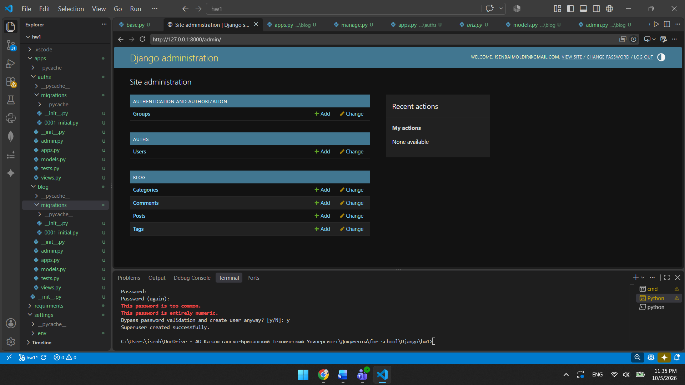

#Django Application

#Homework 3

-- python manage.py queries --number 24     
24 edited_posts — 1 SQL query
Imagine street lose choose
Ahead sea time friend statement understand too
Eight difference company
Rest need then sound process network number
Become red despite sign ability
(29 rows)

--- python manage.py queries --number 6 --sql
6 has_drafts — 1 SQL query
SELECT 1 AS "a" FROM "blog_post" WHERE "blog_post"."status" = 'draft' LIMIT 1
True
